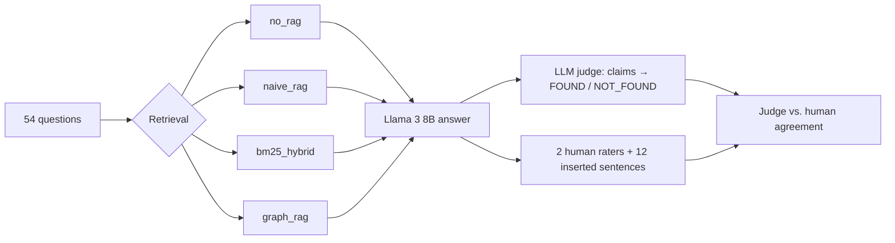

<div align="center">

# Graph-RAG Local Eval

**Can a small local LLM judge tell graph-augmented RAG from vector RAG?**
A cautionary case study with code, questions, human ratings and redacted logs.


-7C3AED)


[Overview](#overview) · [Key findings](#key-findings) · [Quick start](#quick-start) · [Layout](#repository-layout) · [Re-run the judge](#re-run-the-judge-optional) · [Limitations](#limitations) · [Licences](#licences)

</div>

> **Status:** accompanies a manuscript under review at the *Mesopotamian Journal of Computer Science*. Citation and archive DOI will be added on acceptance.

---

## Overview

A fully local pipeline (Llama 3 8B Instruct, 4-bit, served by Ollama on a laptop) answers **54 questions** over a **three-domain corpus** with four systems. The same model also acts as the judge. The study then tests whether that judge can be trusted by comparing it with **two human raters** on a fresh sample of 60 answers, 12 of which carry one inserted unsupported sentence.

| System | Retrieval |
|---|---|
| `no_rag` | none (the model's own knowledge) |
| `naive_rag` | top 4 chunks by vector similarity |
| `bm25_hybrid` | top 4 chunks from equal-weight BM25 + vector fusion |
| `graph_rag` | the same 4 vector chunks plus up to 12 one-hop knowledge-graph triples |



## Key findings

| Question | Result |
|---|---|
| Does the judge catch inserted unsupported sentences? | Flags **2 of 12**; raters flag **8** and **12** |
| Does it separate inserted from unmodified answers? | No detectable difference (Fisher p = 0.62; 0.27 without refusals) |
| Agreement with raters | Weak (r = 0.11 and −0.01) |
| Graph vs. vector faithfulness | No established difference (0.06, p = 0.44); vs. hybrid 0.11, p = 0.11 |
| A second judge (Qwen 2.5 7B) | Also weak agreement with raters |

**Takeaway:** with this judge the retrieval comparison is not interpretable. This is a cautionary case, not evidence that graph retrieval is ineffective or that the systems are equivalent.

## Quick start

Reproduce every published number from the saved logs. No model needed.

```bash
git clone https://github.com/Akramtaha98/graph-rag-local-eval.git
cd graph-rag-local-eval
pip install numpy==2.2.6 scipy==1.15.3 "networkx>=3.2"

python3 analysis.py . analysis_original.json
python3 analysis_v2_final.py . analysis_revised.json
python3 facts.py .
python3 scripts/refusal_audit.py
python3 scripts/analyze_v2.py results
python3 scripts/analysis_r2.py
python3 scripts/analysis_r3.py
```

The bootstrap uses a fixed seed (0), so results reproduce exactly.

## Repository layout

| Path | Content |
|---|---|
| `src/` | ingestion, retrievers, generator, triple extraction, graph store, judges (`evaluate.py`, `evaluate_v2.py`), refusal rule, context guard |
| `scripts/` | re-judging, sampling, agreement and audit analyses, token audit, timing, corpus fetching, context restoration |
| `config.py` | all settings; `RESULTS_DIR` overridable by environment variable |
| `questions.json` | the 54 questions (34 single-hop, 20 multi-hop) |
| `data/docs/` | Common Paper Mutual NDA only (CC BY 4.0) |
| `data/docs_sha256.txt` | SHA-256 of every corpus file used |
| `data/index/` | chunk index (third-party text replaced by IDs), knowledge graph, vectors |
| `results/` | answers, judge scores, human ratings and keys, second-judge outputs, audits, environment report |
| `NOTICES.md` | third-party terms and what is redistributed |
| `Supplementary_Material.pdf` | rating protocol, count matrices, prompts, audits |

<details>
<summary><b>Configuration used</b></summary>

Llama 3 8B Instruct (`llama3:latest`, Q4_0) via Ollama. Generation temperature 0.2; claim extraction and verification temperature 0.0. Embeddings `all-MiniLM-L6-v2`, k = 4. Chunks of 220 words with 40-word overlap. BM25/vector fusion weight 0.5. Graph traversal one hop, 12-triple cap. Original runs used Ollama's default 4,096-token context window; the revised judge sets 8,192 explicitly. See `results/env_report.txt` and `results/ollama_log_evidence.txt`.

</details>

## Re-run the judge (optional)

Needs Ollama with `llama3`. The saved contexts do not contain WHO or RFC text, so first restore a **working copy**. Answers, triples, scores and context order are preserved exactly.

```bash
pip install -r requirements.txt
python3 scripts/fetch_corpus.py        # rebuilds the RFC excerpt; see NOTICES.md for the WHO pages
python3 scripts/restore_contexts.py    # verifies every chunk hash, stops on mismatch
export RESULTS_DIR=results_restored
python3 scripts/check_num_ctx.py
python3 scripts/rejudge_v2.py          # ~1 to 2 hours
python3 scripts/judge_sample_v2.py
python3 scripts/planted_audit.py
```

> Regenerating answers (`run_pipeline.py`) or the sample is **not** a reproduction of the reported validation: generation is unseeded (temperature 0.2).

## Limitations

- One model is both generator and judge.
- Small sample: 54 questions, 60 validated answers, two raters who are colleagues of the authors and were cued to expect an inserted sentence.
- The exact model build of the original runs was not recorded.
- `results/timing.json` has a warm-up artifact and is not used in the paper.

Full list in Section 5 of the paper.

## Licences

Code, questions, outputs and ratings: **MIT** (`LICENSE`). The corpus uses third-party texts with different terms; read `NOTICES.md`. WHO and RFC text is not redistributed. Model outputs and claims may quote sources and are kept as experimental data. WHO does not endorse this work.

## Cite

Citation and DOI will be added on acceptance.
